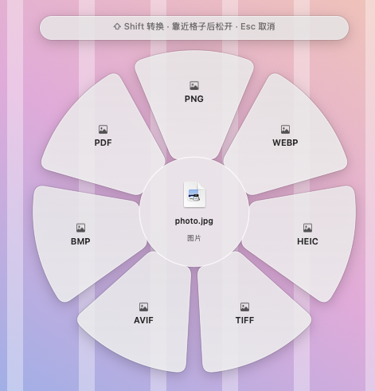
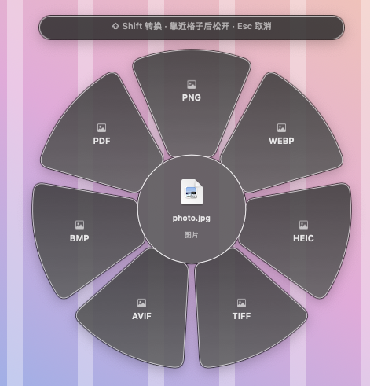
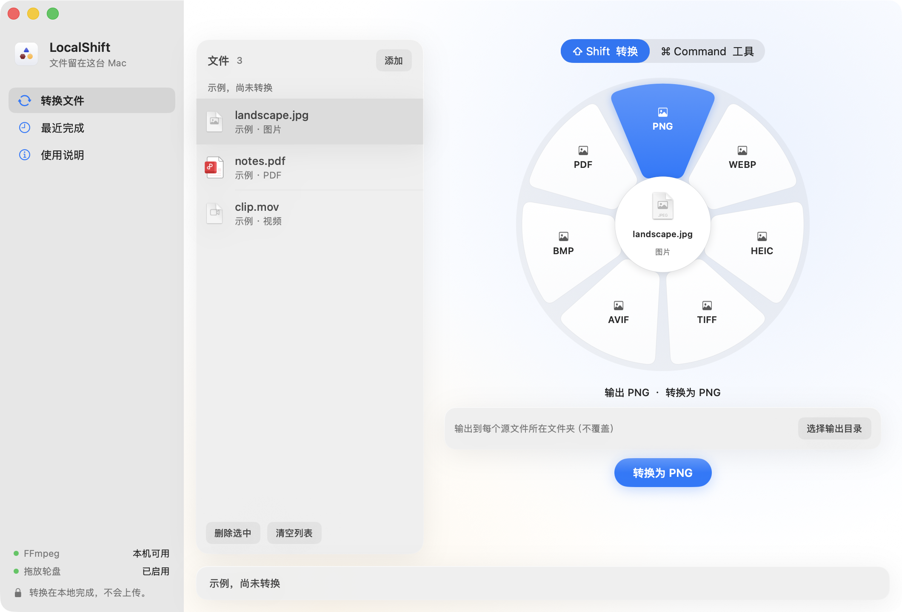
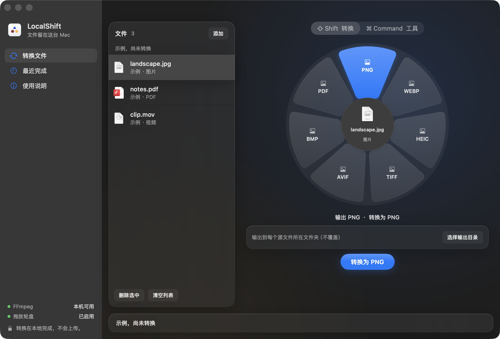
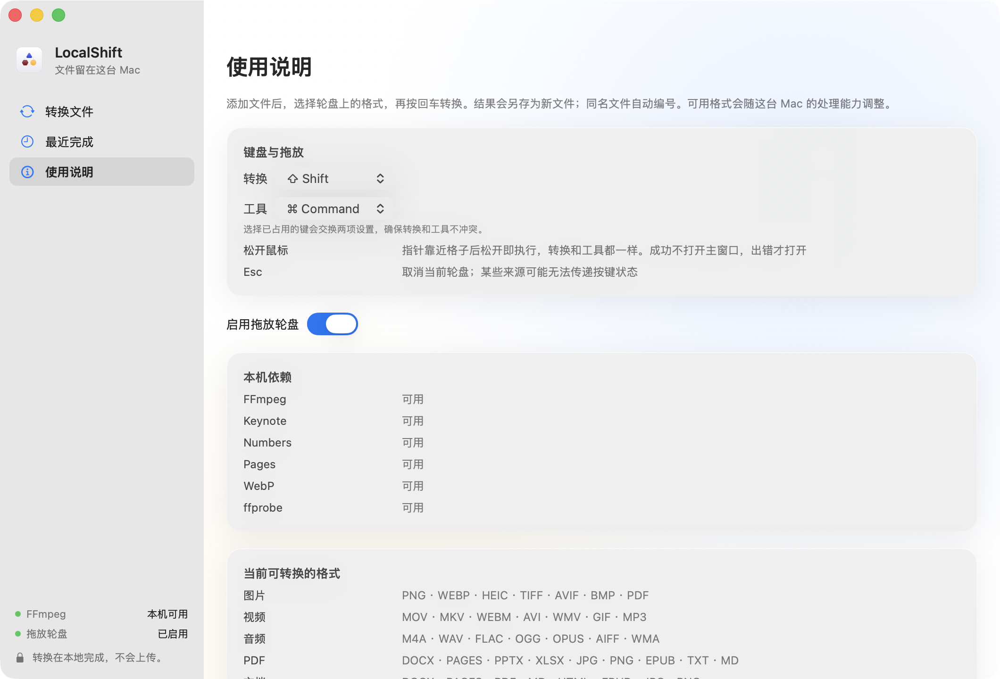

<p align="center">
  
</p>

<h1 align="center">LocalShift</h1>

<p align="center">
  Mac 上的本地文件转换工具。拖着文件按一下 Shift，选格式，松手就转好。<br>
  <b>不上传、不联网、没有遥测，不覆盖原文件。</b>
</p>

<p align="center">
  <a href="https://github.com/MengTang1114-open/m-localshift/releases/latest">下载</a> ·
  <a href="docs/INSTALL.md">安装说明</a> ·
  <a href="CHANGELOG.md">更新记录</a> ·
  <a href="LICENSE">GPLv3</a>
</p>

<p align="center"><i>A local-only file converter for macOS: drag a file, hold Shift, pick a format, let go. Nothing leaves your Mac.</i></p>

---

## 拖放轮盘

在 Finder 或桌面拖着文件时按住修饰键，指针旁会弹出轮盘。移到格子上松开鼠标，结果另存在原文件旁边；成功不打断你，出错才打开主窗口。

| 按键 | 轮盘 | 例子 |
| --- | --- | --- |
| ⇧ Shift | 转换 | 图片转 PNG / WebP / HEIC，视频转 MP4，文档转 PDF |
| ⌘ Command | 工具 | 压缩、裁剪、标注、合并 PDF、识别文字 |
| Esc | 取消 | |

快捷键可以在设置里改。

<p align="center">
  
  
</p>

## 主窗口

不想用快捷键，也可以把文件拖进窗口，在轮盘上点格式，再按「转换」。可以一次放多个文件，排队依次处理。

<p align="center">
  
  
</p>

<p align="center">
  
</p>

## 能做什么

| 类别 | 转换 | 工具 |
| --- | --- | --- |
| 图片 | JPG / PNG / WebP / HEIC / TIFF / SVG / AVIF / BMP 互转，转 PDF | 调整、裁剪、标注、加背景、拼贴、压缩、元数据、遮挡、识别二维码 |
| 音视频 | 常见音频、视频格式互转，GIF ↔ 视频 | 裁剪、裁切画面、调速、拼接、分割、截图、静音、声道、响度标准化、音频可视化、遮挡/消音 |
| PDF | 转图片、文本、DOCX / PPTX / XLSX / Pages / EPUB / Markdown | 拆分、重排、旋转、增删页、合并、压缩、元数据 |
| 文档 / 电子书 | DOCX / Pages / RTF / TXT / Markdown / EPUB 等互转，转 PDF 和图片 | 扫描件本地识字 |
| 表格 / 演示 | XLSX / XLS / ODS / CSV / TSV 互转；PPT / PPTX 转 PDF 和图片 | |
| 字幕 / 归档 | SRT / VTT / TXT；ZIP / TAR / GZ / RAR | 安全解压 |

一共 45 种输入格式、275 个转换方向，完整列表见 [docs/conversion-matrix.json](docs/conversion-matrix.json)。复杂版式、字体、公式不保证完全还原；视频遮挡是固定区域，不做运动追踪。

## 安装

1. 从 [Releases](https://github.com/MengTang1114-open/m-localshift/releases/latest) 下载 `LocalShift-<版本>.dmg`，把 LocalShift 拖进「应用程序」。
2. 第一次打开时 macOS 会拦一下：这个版本还没有 Apple 开发者签名。按 [安装说明](docs/INSTALL.md) 放行一次，之后正常使用。

要求：Apple 芯片（M1 及以后）的 Mac，macOS 13 或更新。FFmpeg、LibreOffice、Python 都已打包在 App 里，不用另外安装。转换 Pages 文件需要装有 Apple Pages。

## 隐私

所有处理都在你的 Mac 上完成。LocalShift 不联网、不上传文件、不收集任何数据；转换结果总是另存为新文件，同名自动编号，不会覆盖原文件。

## 从源码构建

需要 Xcode（Swift 5.9 或更新）。

```bash
swift build                          # 编译
swift test                           # 单元测试（不需要运行库）
python3 tools/bootstrap_runtime.py   # 按锁定版本下载 FFmpeg、Python、LibreOffice
./build.sh                           # 组装 LocalShift.app
tools/make_dmg.sh                    # 打包 dist/LocalShift-<版本>.dmg
```

更多：

- 代码结构和怎么加新的转换：[docs/ARCHITECTURE.md](docs/ARCHITECTURE.md)
- 构建与运行库：[docs/BUILD.md](docs/BUILD.md)
- 发版前的完整验收：[Tests/Acceptance/README.md](Tests/Acceptance/README.md)
- 踩过的坑：[docs/GOTCHA.md](docs/GOTCHA.md)
- 路线图：[docs/ROADMAP.md](docs/ROADMAP.md)
- 维护规则：[AGENTS.md](AGENTS.md)

欢迎提 Issue 和 PR。新增转换方向或工具时，请同时补测试和文档。

## 许可证

LocalShift 以 [GNU GPL v3](LICENSE) 发布。

安装包里附带的第三方运行库各自遵循自己的许可证，全文在 `LocalShift.app/Contents/Resources/Licenses/`：

| 组件 | 许可证 | 源码 |
| --- | --- | --- |
| FFmpeg 9.0.2（Martin Riedl 静态构建） | GPLv3+ | [构建服务](https://ffmpeg.martin-riedl.de/) · [构建脚本](https://git.martin-riedl.de/ffmpeg/build-script) |
| LibreOffice 26.2.6 | MPL 2.0 | [libreoffice.org](https://www.libreoffice.org/about-us/source-code/) |
| Python 3.12 及 Pillow、lxml、python-docx、openpyxl、pypdf、reportlab | PSF 及各自的宽松许可证 | 见各项目 |
| libwebp | BSD | [chromium.googlesource.com/webm/libwebp](https://chromium.googlesource.com/webm/libwebp) |

锁定的下载地址和 sha256 在 [tools/runtime.lock.json](tools/runtime.lock.json)。
